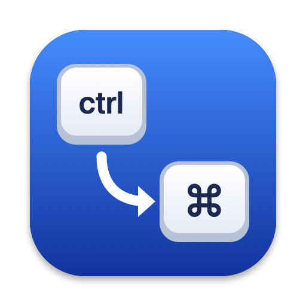

<p align="center"></p>

# KeyBridge — Windows & Linux keyboard shortcuts on Mac

[](https://github.com/emajidov/keybridge/actions/workflows/ci.yml)
[](https://github.com/emajidov/keybridge/releases/latest)
[](LICENSE)

[](https://github.com/emajidov/homebrew-tap)

**KeyBridge** is a free, open-source macOS menu bar app for people who switch between Windows/Linux and Mac every day.
Keep pressing **Ctrl+C / Ctrl+V / Ctrl+Z …** on your Mac and KeyBridge sends the Mac equivalent (**⌘C / ⌘V / ⌘Z …**).
Your normal ⌘ shortcuts keep working.

🌐 **Website:** https://emajidov.github.io/keybridge/ · ⬇️ **[Download the latest release](https://github.com/emajidov/keybridge/releases/latest)** · 🍺 **Homebrew:**

```bash
brew install --cask emajidov/tap/keybridge
```

## Why KeyBridge?
- **Keep your muscle memory.** Use Ctrl shortcuts from Windows or Linux on your Mac without retraining your fingers.
- **Doesn't break your Mac.** It only adds shortcuts. ⌘ still works, and terminals still get a real Ctrl+C.
- **Private.** It runs offline, collects nothing, and never connects to the internet.
- **Small and native.** Written in Swift/SwiftUI with no dependencies.

## Features
- Ready-made Windows-style shortcuts: copy, paste, cut, select all, undo/redo (Ctrl+Y too), save, find, new, open, print, tabs, reload, address bar, bold/italic/underline.
- Windows text navigation: Ctrl+←/→ jumps words, Home/End go to line start/end, Ctrl+Home/End go to document start/end, Ctrl+Backspace/Delete deletes a word.
- An "Also with Shift" option, so Shift+Home, Ctrl+Shift+→ and similar shortcuts select text like on Windows.
- Add, edit, disable, reorder or delete any shortcut by recording it.
- Excluded apps: terminals (Terminal, iTerm2, Warp, Ghostty, kitty, Alacritty, WezTerm, Hyper, Tabby), virtual machines and remote desktops are skipped by default. You can toggle the current app from the menu bar.
- Launch at login.
- Runs in the background: hide the menu bar icon, and (on by default) **Quit** only hides the icon so your shortcuts keep working. Open KeyBridge from Applications or Spotlight to bring it back; use **Quit Completely** in Settings to stop it. Turn on **Launch at login** to keep it running after a restart.

### Default shortcuts
| Windows / Linux | Mac | Action |
|---|---|---|
| Ctrl+C / X / V | ⌘C / X / V | Copy / Cut / Paste |
| Ctrl+A | ⌘A | Select all |
| Ctrl+Z, Ctrl+Y, Ctrl+Shift+Z | ⌘Z, ⌘⇧Z | Undo / Redo |
| Ctrl+S, Ctrl+F, Ctrl+N, Ctrl+O, Ctrl+P | ⌘S, ⌘F, ⌘N, ⌘O, ⌘P | Save, Find, New, Open, Print |
| Ctrl+T, Ctrl+W, Ctrl+R, Ctrl+L | ⌘T, ⌘W, ⌘R, ⌘L | Tabs, Reload, Address bar |
| Ctrl+B / I / U | ⌘B / I / U | Bold / Italic / Underline |
| Ctrl+← / → | ⌥← / → | Jump word |
| Home / End | ⌘← / → | Line start / end |
| Ctrl+Home / End | ⌘↑ / ↓ | Document start / end |
| Ctrl+Backspace / Delete | ⌥⌫ / ⌥⌦ | Delete word |

## Install
### Option 1: Homebrew (recommended)
```bash
brew install --cask emajidov/tap/keybridge
```
- Update: `brew upgrade --cask keybridge`
- Uninstall: `brew uninstall --cask keybridge` (add `--zap` to also remove settings)

The Homebrew install clears macOS's "downloaded from the internet" flag, so you won't see Apple's malware warning. You only need step 3 below (Accessibility).

### Option 2: Download
1. Download **`KeyBridge.dmg`** from the [latest release](https://github.com/emajidov/keybridge/releases/latest), open it and drag **KeyBridge** into the **Applications** folder. (A `KeyBridge.zip` is also available if you prefer.)
2. The first time you open it, macOS shows *"Apple could not verify “KeyBridge” is free of malware…"*. This is expected; see [Troubleshooting](#apple-could-not-verify-keybridge-is-free-of-malware) for how to open it.
3. Grant **Accessibility** access when asked: System Settings → Privacy & Security → Accessibility → enable KeyBridge.

## Build from source
Requires macOS 13+ and Xcode or the Command Line Tools.

```bash
git clone https://github.com/emajidov/keybridge.git
cd keybridge
./build.sh
open build/KeyBridge.app
```

`build.sh` creates `build/KeyBridge.app`, the installer `build/KeyBridge.dmg` and `build/KeyBridge.zip`. Pushing a `v*` tag (e.g. `git tag v1.0.1 && git push origin v1.0.1`) makes GitHub Actions build them and attach them to a GitHub release.

The app is ad-hoc signed. After you rebuild it, you may need to remove KeyBridge from the Accessibility list and add it again.

### Tests
```bash
swift test   # with Command Line Tools only, prefix with SDKROOT=<SDK chosen by build.sh>
```

## Troubleshooting

### "Apple could not verify “KeyBridge” is free of malware"
When you open KeyBridge for the first time, macOS may show:

> Apple could not verify “KeyBridge” is free of malware that may harm your Mac or compromise your privacy.

**Why:** KeyBridge is open source and free, so it isn't signed with a paid Apple Developer ID or notarized by Apple. macOS blocks any downloaded app that Apple hasn't notarized. You can read and build all of the source code in this repository.

**Fix (pick one):**
- **Install with Homebrew:** `brew install --cask emajidov/tap/keybridge`. The cask clears the quarantine flag, so the warning doesn't appear.
- **Open Anyway:** click **Done** on the warning, open **System Settings → Privacy & Security**, scroll down to the message about KeyBridge and click **Open Anyway**, then confirm. On macOS 14 and earlier you can also right-click the app and choose **Open**.
- **Terminal:** remove the quarantine flag, then open the app again:
  ```bash
  xattr -dr com.apple.quarantine /Applications/KeyBridge.app
  ```

You only need to do this once per install.

### Shortcuts don't work after installing or updating
- Make sure KeyBridge is on in **System Settings → Privacy & Security → Accessibility**.
- If KeyBridge is listed more than once, or it's on but shortcuts still don't work, remove every KeyBridge entry with **–**, then open KeyBridge again and grant access once more. You can also reset the permission in Terminal: `tccutil reset Accessibility io.github.keybridge.KeyBridge`.
- Keep only one copy of the app (for example, the one in `/Applications`). Each copy gets its own Accessibility entry.

## FAQ
**How do I use Ctrl+C and Ctrl+V on a Mac?** Install KeyBridge. Ctrl+C and Ctrl+V will then copy and paste like they do on Windows.

**Will Ctrl+C still stop commands in Terminal?** Yes. Common terminals are excluded by default. For other terminals (e.g. the VS Code terminal), add the app under Excluded Apps or use "Disable in <app>" from the menu bar.

**Does it work in VMs or remote desktops (Parallels, VMware, UTM, Windows App)?** These apps are excluded by default, so Windows inside them gets the real keys.

**Some shortcuts don't work (e.g. Ctrl+← / →).** macOS reserves these to switch Spaces. Turn them off in System Settings → Keyboard → Keyboard Shortcuts → Mission Control.

**Do my shortcuts keep working after I quit KeyBridge or restart my Mac?** Yes. With **Keep running after Quit** on (the default), Quit only hides the menu bar icon. Turn on **Launch at login** so KeyBridge starts again after a restart. To stop it completely, use **Quit Completely** in Settings → General.

**Can I swap Ctrl and ⌘ everywhere instead?** Yes. macOS has that built in: System Settings → Keyboard → Keyboard Shortcuts → Modifier Keys.

## Contributing
Contributions are welcome. Read [CONTRIBUTING.md](CONTRIBUTING.md) before you start. If KeyBridge helps you, please ⭐ the repo so other people can find it.

## License
[Apache License 2.0](LICENSE) © 2026 Elgun Majidov
